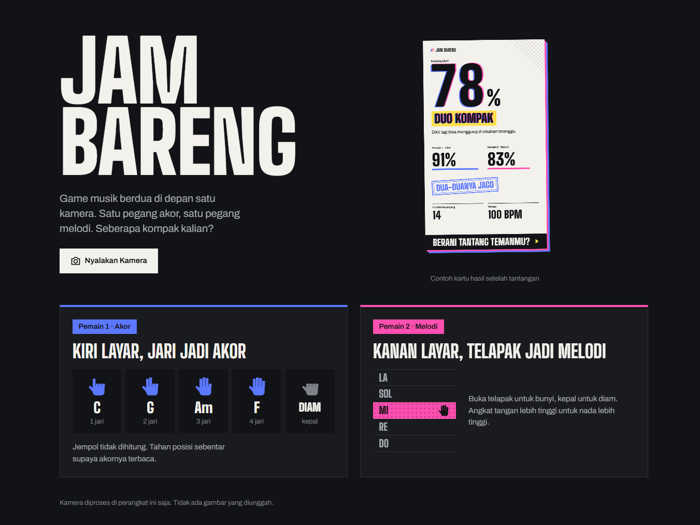
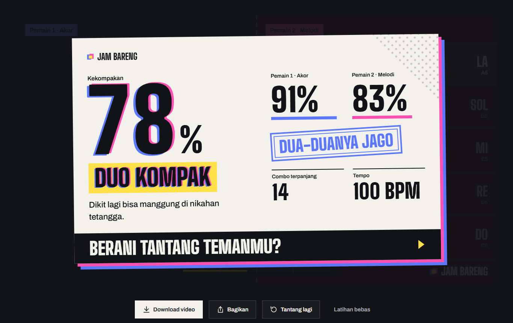

# Jam Bareng

Game musik untuk dua orang di depan satu webcam, dimainkan dengan gerakan tangan. Pemain 1 (kiri layar) memegang akor lewat jumlah jari, Pemain 2 (kanan layar) memainkan melodi dengan tinggi telapak. Tantangan 16 birama mengukur seberapa kompak kalian, lalu hasilnya bisa diunduh sebagai video untuk TikTok atau Reels.



## Fitur

- **Tiga level.** Gampang: progresi C-G-Am-F dengan pola melodi tetap. Sedang: akor dan melodi diacak tiap 2 birama. Susah: diacak tiap birama.
- **Empat groove.** Pop, Koplo (kendang sintetis dhut, tak, ket), Punk (snare di ketukan 2 dan 4), Lo-fi (swing, lebih lembut). Semua dibuat dari synth, tanpa sampel.
- **Cek posisi.** Setelah "Mulai Tantangan", hitung mundur baru berjalan setelah kedua tangan terlihat di sisi masing-masing selama 0,7 detik. "Langsung mulai" melewati cek ini, "Batal" membatalkannya.
- **Link tantangan.** Setiap tantangan punya kode (misalnya `K7Q2M`) yang mengunci urutan akor dan melodi. "Salin link tantangan" membuat link berisi kode, level, tempo, groove, dan skor kalian. Teman yang membukanya memainkan urutan yang persis sama, dan kartu hasilnya menampilkan MENANG, SERI, atau KALAH.
- **Rekor pasangan.** Skor terbaik per level disimpan di browser ini dan tampil di kartu hasil ("Rekor kalian" atau "Rekor baru").
- **Tiga hasil untuk dibagikan.** Video penuh, video pendek (2 birama pertama, 3 birama terakhir, dan kartu hasil, sekitar 16 sampai 22 detik tergantung tempo), dan gambar PNG 9:16 dari kartu hasil. "Bagikan" mengirim video pendek beserta link tantangan.
- Pilihan tempo, level, groove, format, dan rekam diingat di browser.

## Menjalankan di lokal

Butuh Node.js 20.19 atau lebih baru.

```bash
npm install
npm run dev
```

Buka `http://localhost:5173`. Kamera hanya bisa dipakai lewat `localhost` atau HTTPS. Untuk mencoba dari ponsel di jaringan yang sama, pakai alamat jaringan yang dicetak Vite. Browser ponsel mewajibkan HTTPS, jadi cara paling mudah adalah deploy preview (lihat bagian Deploy).

```bash
npm run build     # cek tipe + build produksi ke dist/
npm run preview   # sajikan hasil build
```

`predev` dan `prebuild` otomatis menyalin berkas wasm MediaPipe dari `node_modules` ke `public/mediapipe`, sehingga runtime dimuat dari domain sendiri.

### Mode demo (tanpa kamera)

Berguna untuk screenshot dan mengecek tampilan:

- `/?demo=result` untuk kartu hasil dengan data contoh
- `/?demo=hud` untuk HUD tantangan dengan tangan sintetis
- `/?demo=ready` untuk layar cek posisi
- `/?t=K7Q2M&l=susah&b=120&g=koplo&s=71` untuk mencoba link tantangan
- tambah `&format=vertical` untuk versi 9:16

## Deploy

Jam Bareng adalah situs statis (`npm run build` menghasilkan folder `dist`). Hosting apa pun yang memberi HTTPS bisa dipakai, karena kamera hanya jalan lewat HTTPS. Butuh Node 20.19 atau lebih baru (lihat `.nvmrc`).

### Cloudflare Pages (disarankan)

Tampil di akar domain (`<nama-proyek>.pages.dev`), gratis tanpa batas bandwidth, dan punya server di Jakarta.

1. Push folder ini ke repo GitHub atau GitLab.
2. Di dashboard Cloudflare pilih **Workers & Pages > Create > Pages > Connect to Git**, lalu pilih repo-nya.
3. Framework preset **Vite**, build command `npm run build`, output directory `dist`.
4. Di **Environment variables** tambahkan `NODE_VERSION` = `22`.
5. Save and Deploy. Setiap push berikutnya otomatis ter-deploy, dan setiap branch dapat URL preview sendiri.

Tanpa repo juga bisa: `npm run build`, lalu `npx wrangler pages deploy dist --project-name jam-bareng`.

File `public/_headers` mengatur cache panjang untuk runtime MediaPipe di Cloudflare.

### GitHub Pages

Bisa juga, tetapi situs proyek tampil di subfolder (`namaanda.github.io/jam-bareng/`). Kode sudah aman untuk subfolder. Build dengan `npm run build -- --base=/jam-bareng/` lalu terbitkan folder `dist` lewat GitHub Actions.

### Vercel

Impor repo di Vercel. Build command `npm run build` dan output `dist` sudah diatur di `vercel.json`. Atau lewat CLI: `npx vercel --prod`.

## Struktur kode

| Berkas | Isi |
| --- | --- |
| `src/tracking.ts` | HandLandmarker (VIDEO, 2 tangan, GPU dengan cadangan CPU), hitung jari, pembagian pemain dari landmark 9, debounce |
| `src/audio.ts` | Synth Web Audio: kick, hi-hat, strum sawtooth + lowpass, pluck triangle + square, cymbal, trombon sedih, ketukan hitung mundur |
| `src/game.ts` | Penjadwal 1/16 berbasis `AudioContext.currentTime` (lookahead 100 ms), pola groove, urutan per level, alur latihan bebas, hitung mundur, tantangan, penilaian, data kartu hasil |
| `src/challenge.ts` | Kode tantangan dan RNG ber-seed, baca dan buat link tantangan, rekor dan pengaturan di `localStorage` |
| `src/render.ts` | Semua visual di satu canvas: kamera (crop cover, dicerminkan), HUD, efek, kartu hasil, tata letak 16:9 dan 9:16 |
| `src/paint.ts` | Primitif gambar: teks cetak meleset, stiker, halftone, partikel |
| `src/recorder.ts` | `canvas.captureStream(30)` + audio dari `MediaStreamDestination`, memilih mp4 (avc1) bila didukung, kalau tidak webm |
| `src/tokens.ts` | Token desain bersama: warna, font, skala spasi 4px, ukuran teks, durasi gerak. Ditulis ke CSS custom properties dan dipakai langsung oleh canvas |
| `src/icons.ts` | Ikon SVG buatan sendiri |
| `src/main.ts` | Perakitan: layar pembuka, kontrol, loop frame, rekam dan bagikan, mode demo |

## Arah desain

**Flyer gig kampus yang dicetak risograf.** Kertas, dua tinta yang sedikit meleset, dan stiker yang ditempel di dinding. Karakternya lantang, kompak, dan iseng.

- **Kontrol tenang, momen ramai.** Tombol, label, dan bar kontrol memakai ramp netral gelap dan teks sentence case. Tinta penuh hanya muncul di dua momen: reaksi di canvas (KOMPAK!, FALS!, kartu target akor) dan kartu hasil.
- **Palet.** Tinta `#121316`, kertas `#f3f1ec`. Biru riso `#5b78ff` untuk Pemain 1 dan magenta fluo `#ff4fb0` untuk Pemain 2, dipakai seperti warna seri data di seluruh UI. Kuning `#ffe14a` hanya untuk momen kompak, vermilion `#ff5a2b` hanya untuk fals dan indikator rekam.
- **Tipografi.** Big Shoulders Display (kondensed, ala poster gig) untuk angka dan teks momen, selalu kapital. Archivo untuk antarmuka, bobot 400 sampai 600. Keduanya di-host sendiri lewat `@fontsource-variable`.
- **Signature.** Cetak meleset biru-magenta, hanya di tiga tempat: nama akor target, persen kekompakan, dan gelar di kartu hasil. Halftone hanya menandai jalur target dan sudut kartu hasil.
- **Bentuk.** Semua sudut tajam (radius 0) seperti potongan kertas. Bayangan keras tanpa blur hanya pada stiker di momen.
- **Gerak.** Satu kurva `cubic-bezier(0.22, 1, 0.36, 1)`. Guncangan, kilatan, dan partikel hanya sebagai umpan balik permainan. Di `prefers-reduced-motion`, guncangan dan skala dimatikan.

Prosesnya: arah dari skill taste-skill (design-taste-frontend), lalu audit dan sembilan pass dari [unslop](https://heydamir.design/unslop) oleh Damir Sokolovsky (@heydamir), CC BY 4.0.



### Pengecualian yang disengaja dari kedua skill

- **Ikon digambar sendiri**, bukan dari pustaka ikon, sesuai aturan proyek.
- **Satu tema gelap.** Canvas adalah frame video yang direkam, jadi tampilannya harus sama di semua perangkat.
- **Teks reaksi tebal, kapital, dengan tanda seru** (KOMPAK!, FALS!, ON FIRE!) karena itu konten permainan, bukan label antarmuka.
- **Tanpa foto.** Visual utamanya kamera para pemain. Layar pembuka memakai pratinjau kartu hasil asli yang dirender oleh renderer yang sama.

## Keputusan yang diambil

Bagian spesifikasi yang belum tegas diputuskan sebagai berikut:

- **Dua tangan di sisi yang sama.** Tangan pertama yang terdeteksi dipakai, tangan kedua diabaikan.
- **Tinggi telapak.** Diukur dari landmark 9, relatif terhadap area pemain di layar (di 9:16, area Pemain 2 adalah separuh bawah). Di bawah 0,1 dianggap Do, di atas 0,9 dianggap La.
- **Waktu penilaian.** Drum dijadwalkan 100 ms ke depan, tetapi akor dan melodi baru diputuskan 30 ms sebelum ketukan. Ada toleransi telat 160 ms: tangan yang baru sampai di posisi benar dalam jendela itu tetap dibunyikan benar (sedikit telat) dan dihitung kompak. Bila sampai jendela habis masih salah, nadanya dibunyikan fals.
- **Akor dan melodi acak.** Setiap tantangan membuat urutan baru. Akor tiap birama dipilih acak dari C, G, Am, F (semuanya akor di kunci C, jadi kombinasi apa pun tetap enak didengar) dan tidak pernah sama dengan birama sebelumnya. Target melodi tiap birama dipilih acak dari nada akor yang ada di 5 jalur (C: Do/Mi/Sol, G: Re/Sol, Am: Do/Mi/La, F: Do/La), juga tidak pernah sama dengan jalur birama sebelumnya. Ini menggantikan progresi tetap C-G-Am-F dan pola tetap C ke Mi, G ke Sol, Am ke La, F ke Do dari spesifikasi awal, supaya tidak bisa dihafal. Akor penutup tetap C.
- **Aba-aba jalur berikutnya.** Di ketukan ke-4 setiap birama, jalur melodi untuk akor berikutnya diberi garis putus-putus dan label "Berikutnya", supaya Pemain 2 bisa bergerak sebelum akor berganti.
- **Penghalus input melodi.** Membuka telapak langsung terbaca, tetapi kepal baru diterima setelah 3 frame. Tangan yang hilang dari deteksi kurang dari 4 frame tidak memutus nada. Pindah jalur butuh melewati batas sejauh seperempat tinggi jalur, supaya telapak di perbatasan tidak meloncat-loncat. Akor Pemain 1 tetap memakai debounce 3 frame.
- **Hitung mundur.** Hanya bunyi ketukan dan hi-hat, tanpa kick dan akor, supaya aba-abanya jelas. Pemain boleh bersiap-siap selama hitung mundur.
- **Fals saat diam.** Bila pemain yang seharusnya bunyi malah kepal, tidak ada nada yang dibunyikan, tetapi tetap dihitung salah dan efek gagal tetap muncul.
- **Seed.** Urutan dibuat dari `kode:level`, jadi kode yang sama di level berbeda menghasilkan urutan berbeda. Link hanya diterima bila kode, level, tempo (84, 100, 120), groove, dan skor (0 sampai 100) valid.
- **Link teman mengunci pengaturan.** Tempo, level, dan groove dikunci sesuai link supaya adil. Format video tetap bebas. "Lepas" di bar kontrol kembali ke main biasa. "Tantang lagi" dari link memakai kode yang sama.
- **Video pendek** direkam bersamaan dengan video penuh lewat perekam kedua yang dijeda di ketukan 9 dan dilanjutkan di ketukan 53. Isinya bagian awal dan akhir, bukan momen terbaik pilihan otomatis, karena memilih momen terbaik butuh mengedit video di browser (ffmpeg.wasm, puluhan MB). Dua perekam sekaligus lebih berat untuk ponsel lama, dan keduanya ikut mati bila "Rekam otomatis" dimatikan.
- **Rekor** disimpan per level saja, tidak per groove atau tempo.
- **Combo putus.** Trombon dan teks "COMBO PUTUS" muncul bila combo minimal 4 putus. Denting kecil berbunyi saat combo mencapai 8, lalu setiap kelipatan 16.
- **Biang kerok.** "Dua-duanya jago" bila kedua akurasi minimal 80%. "Sama-sama bikin kacau" bila selisihnya di bawah 10 poin. Selain itu, pemain dengan akurasi lebih rendah.
- **Akhir tantangan.** Kartu hasil muncul 2 ketukan setelah akor penutup. Rekaman berhenti 4 detik setelah kartu muncul. Selama itu tombol download menampilkan "Menyiapkan video".
- **Tempo, format, dan rekam** dikunci selama tantangan berjalan.
- **Format 9:16.** Panel ketukan dipindah ke atas agar tidak menutupi label dan jalur Pemain 2 di garis tengah.
- **Model tangan** dimuat dari Google Cloud Storage (`hand_landmarker.task`, sekitar 8 MB), jadi butuh internet saat pertama dibuka.
- **Bagikan** hanya muncul bila `navigator.canShare({ files })` menyetujui berkas videonya (umumnya Chrome Android dan Safari iOS).

## Catatan kompatibilitas

- Chrome desktop dan Android merekam mp4 (avc1) bila tersedia, kalau tidak webm.
- Safari iOS merekam mp4. AudioContext dibuat saat tombol "Nyalakan Kamera" ditekan agar diizinkan iOS.
- Alur kamera, pelacakan, penjadwal, dan perekam sudah diuji di Chrome desktop. Chrome Android dan Safari iOS belum dicoba di perangkat sungguhan, jadi cek dulu di sana sebelum dipromosikan.

Lisensi font: Big Shoulders Display dan Archivo, SIL Open Font License.
